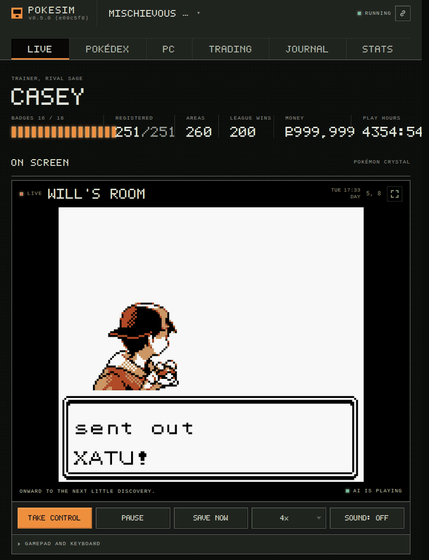
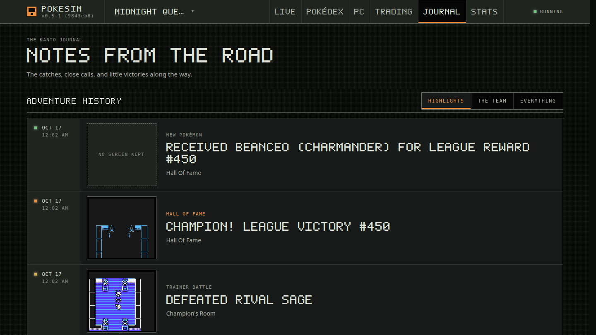
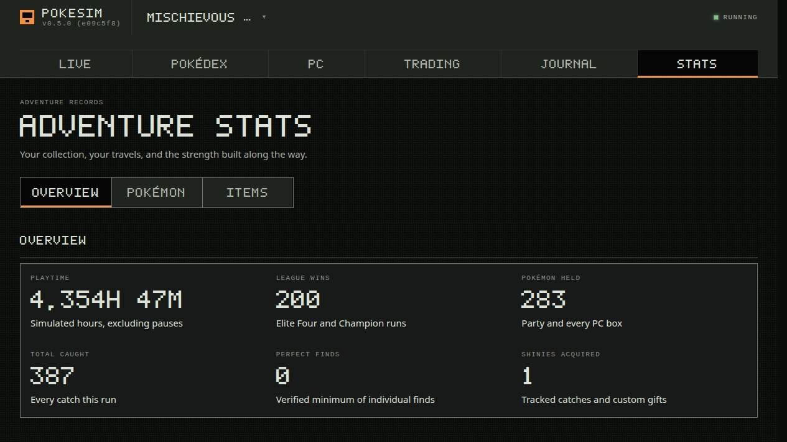
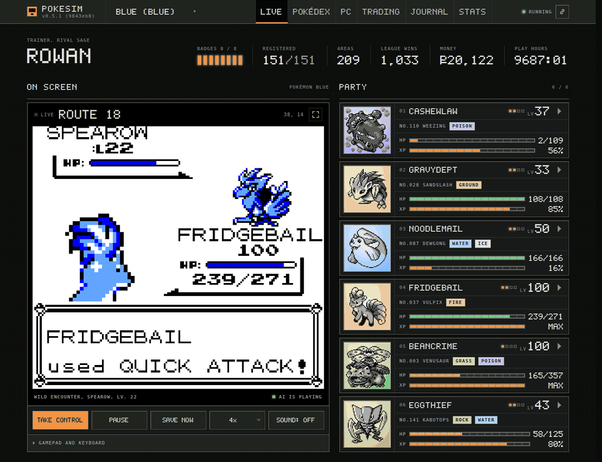
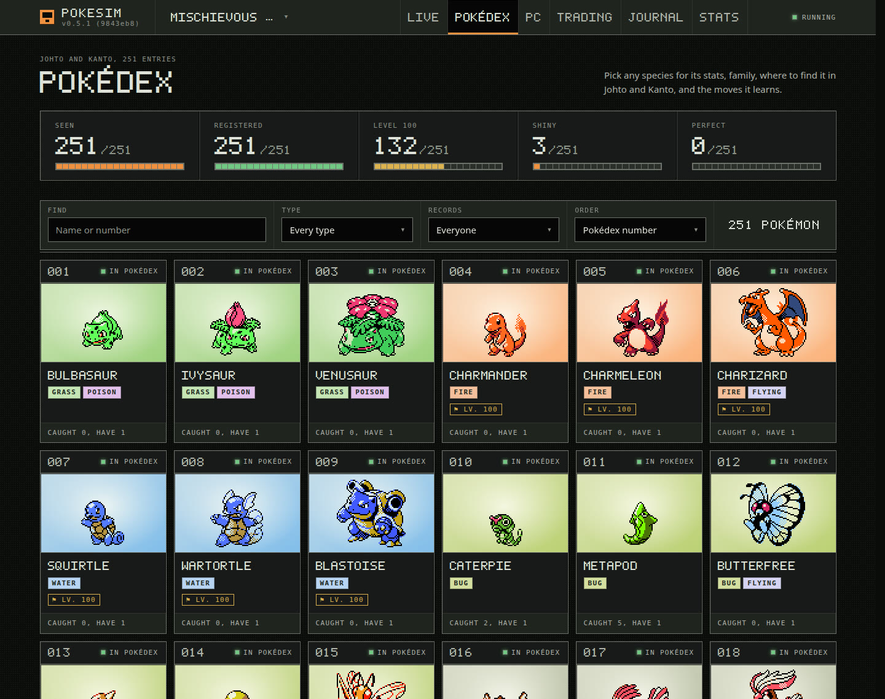
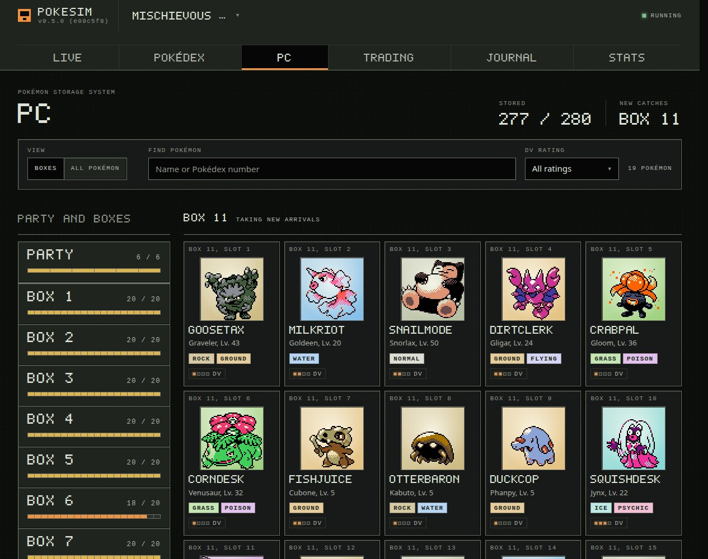
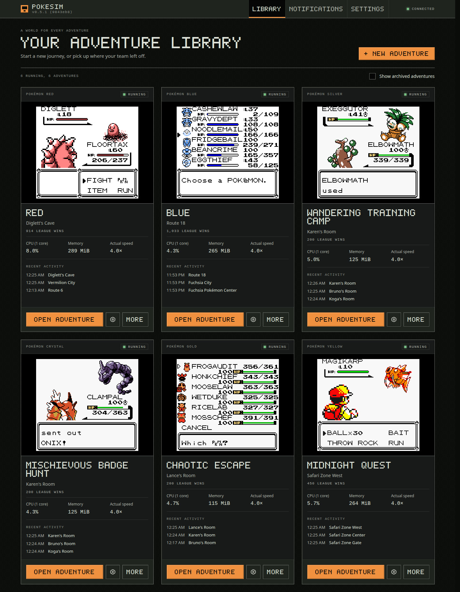

# PokeSim

**Pokémon Red, Blue, Yellow, Gold, Silver and Crystal that play themselves while you're away.**



Watch an automatic player catch Pokémon, earn badges and challenge the League in
your browser. Take control whenever you like, then hand the adventure back.
Everything runs locally, with no model API or subscription.

## Keep the adventure going

- **Many games side by side:** Run any mix of Generation I and II adventures, each with
  its own saves and speed. Check CPU, memory and observed speed in the Library.
- **A growing collection:** Explore the Pokédex and search every PC box. Compare
  power, types and DV quality to find promising Pokémon.
- **They trade with each other:** Adventures meet in the in-game Cable Club and
  exchange Pokémon over a virtual link cable, including trade evolutions. Generation I
  and II games trade with each other through the Time Capsule.
- **Milestones and stats:** Follow catches, League wins, collection strength and
  marathon personal bests in the Journal.
- **Life after the League:** Keep training, rotate League teammates, revisit
  eligible encounters and earn new Pokémon.
- **Your own touch:** Add nickname prefixes and suffixes, take over the controls,
  or export your save to continue in another emulator.

| Journal entries | Adventure stats |
| --- | --- |
| [](docs/images/journal-panel.jpg) | [](docs/images/stats-panel.jpg) |

## Generation I: Red, Blue and Yellow



Red and Blue adventures play the Kanto story to the Hall of Fame and keep going.
Yellow starts with Pikachu and follows its own story, including Jessie and James
and the gift starters. Exports are a standard `.sav`.

## Generation II: Gold, Silver and Crystal

Gold, Silver and Crystal adventures earn all 16 badges, beat Red and work toward the
251-species Pokédex, with breeding, held items and roaming beasts. Crystal adds the
Battle Tower and an optional Celebi event.

The cartridge clock that decides day, night and weekday events runs on game time. At 1x
it keeps pace with a console, and at Max the days pass as fast as the run plays. Exports
are a `.zip` holding the `.sav` and its `.rtc` clock file. Put both next to the ROM.
[How the clock works](docs/guide.md) and [cartridge details](docs/gen2-exploration.md).

## The collection is half the fun

Want every species? Run more than one game and let them trade version exclusives
and trade evolutions automatically, across generations too. New adventures created in the
Library have these rewards and return visits **enabled by default**, so the collection
keeps growing beyond the original games' one-time encounters:

- **Another Eevee, another fossil (Generation I):** After becoming Champion and
  unlocking the original events, revisit gifts, fossils, the Fighting Dojo and
  supported NPC trades after **100,000 steps** by default.
- **Legendary rematches:** Previously acquired legendary birds and Mewtwo, or
  the legendary beasts, Lugia and Ho-Oh, return to be caught again every
  **1,000,000 steps** by default. Sudowoodo and Snorlax return in Generation II too.
- **A mythical reward:** A custom Mew gift arrives in the PC after your first
  League win. Mew isn't normally obtainable in these games. Another
  million steps followed by a new League win earns another.
- **More starters:** Receive a random Kanto starter in Generation I, or a random
  Johto starter in Generation II, after each new League win.

Change or disable these rewards in each adventure's settings.
[How return visits work](docs/step-rewards.md).

| Pokédex | PC collection |
| --- | --- |
| [](docs/images/pokedex-panel.jpg) | [](docs/images/pc-panel.jpg) |

## A few extras for the long run

- **Meet WAFFLEKING:** 6,117 built-in nicknames, plus your own prefixes
  and suffixes. Every collection deserves a few questionable names.
- **Milestones in your pocket:** Catch updates and adventure screenshots through
  ntfy, Discord or Telegram.
- **The Kanto Marathon:** Sometimes the next big goal is a run around Kanto.
  Follow the race and see whether your trainer beats their personal best.

Follow the [changelog](CHANGELOG.md) for new additions.

## Your adventure library

Manage games in one place, with live screens, recent activity, CPU and memory
usage, and the speed each simulation is actually reaching. Each game you own gets
one cartridge slot in Settings → Game cartridges. Drop a ROM on any slot and PokeSim
recognises the game and files it in the right one. New adventure then lets you pick
from the cartridges you have installed.



## Install

Bring your own supported Pokémon Red, Blue, Yellow, Gold, Silver or Crystal ROM that you are
entitled to use. Supported builds are English USA/Europe, with Crystal Rev 1.
Professor Oak supplies starters, not ROMs. PokeSim does not
include or download ROMs. Your ROM stays on the machine running PokeSim.

### Server: Docker Compose

On an x86-64 machine with Docker Compose, create a new installation folder:

```sh
mkdir pokesim
cd pokesim
curl -fL --retry 3 -o compose.yaml https://github.com/afk-sapien/PokeSim/releases/latest/download/compose.quickstart.yaml
docker compose up -d --wait
```

Open [localhost:8930](http://localhost:8930), add your ROM in Settings → Game cartridges and create an adventure.
On Windows PowerShell, use `curl.exe`. Docker keeps your library in a persistent
volume. Keep this folder for future Compose commands.

**Already installed?** Keep your existing Compose file and data mount. Back up
before upgrading, since Yellow, Gold, Silver and Crystal adventures cannot be opened by
earlier releases. See [update and roll back](docs/operations.md#update-and-roll-back). The [self-hosting guide](docs/self-hosting.md) covers updates,
remote access and custom ports.

### Desktop: install with uv

Install [uv](https://docs.astral.sh/uv/getting-started/installation/) using your
package manager:

| Platform | Command |
| --- | --- |
| Windows with WinGet | `winget install --id astral-sh.uv --exact` |
| macOS with Homebrew | `brew install uv` |
| Linux with pipx | `pipx install uv`, then `pipx ensurepath` |

Open a new terminal, then install the current public release:

```sh
uv tool install --python 3.12 --managed-python https://github.com/afk-sapien/PokeSim/releases/download/v0.6.0/pokesim-0.6.0-py3-none-any.whl
uv tool update-shell
```

Open another terminal and run `pokesim-desktop`. It opens the Library in your
browser. uv manages Python for you. See the [desktop guide](docs/desktop.md) for
package-manager prerequisites, updates and removal.

Games continue after you close the browser tab. Keep the host awake and use
**Save and quit** to stop cleanly. The Library has no login, so anyone who can
reach it can manage it. Default installations bind to localhost. Never expose it
directly to the internet. For remote access, put it behind something that adds
authentication, such as Tailscale, Cloudflare Access, or your own reverse proxy with
a login.

## Help and documentation

Adventures can reach the Hall of Fame, but the automatic player can still get stuck.
See [release status and known limits](RELEASE_STATUS.md).

- [Gameplay and notifications](docs/guide.md)
- [Statistics and counting rules](docs/adventure-statistics.md)
- [Backups and troubleshooting](docs/operations.md)
- [Authentication and view links](docs/authentication.md)
- [Report a bug or request a feature](https://github.com/afk-sapien/PokeSim/issues)
- [Discussions](https://github.com/afk-sapien/PokeSim/discussions) and [contributing](CONTRIBUTING.md)
- [Security](SECURITY.md) and [community guidelines](CODE_OF_CONDUCT.md)

PokeSim is an unofficial fan project, unaffiliated with Pokémon's rights holders.
Code is [MIT licensed](LICENSE). ROMs and generated game data are not distributed.
AI coding assistance was used during development. The automatic player uses local
rules. See [third-party notices](THIRD_PARTY_NOTICES.md) and [dependency licenses](docs/licensing.md).
