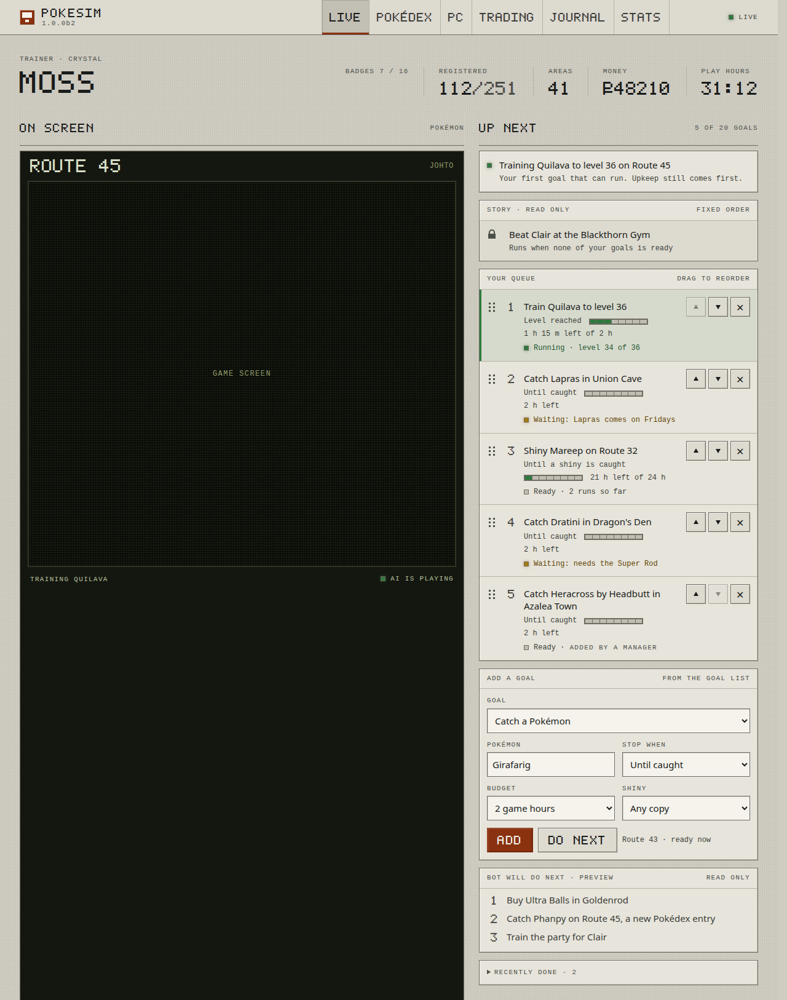
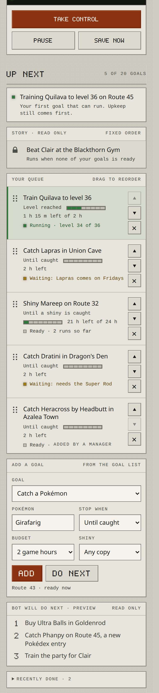

# Goal queue

Status: proposed on 2026-11-12. Nothing here is built. Every line number was read from main at `d7ac1900` (#580). It builds on the pin and the catalogue of [Typed goals](typed-goals.md) section 5, the director of [Decide pipeline](decide-pipeline.md) section 3, the protocol of [One bot](one-bot.md) section 1 and the hunt template of [Goal system v2](goal-system.md) section 3.

Today a manager picks the next activity from the Choose next picker at the bottom of the adventure page. It holds one goal. It lives in memory, ends after one run of its goal, and a load, a restart or a stall clears it. This note replaces it with a goal queue: an ordered, saved list of goals at the top of the page that a manager can add to and drag to reorder. The bot runs the first entry that can run, every entry that waits says why, and every entry ends by a rule, so no goal can hold the bot forever.

## Owner choices

Five choices are the owner's. Each has a recommendation, and the rest of the note follows it.

1. **Before the Champion, does a ready entry run ahead of the next story goal?** The other way is to run it only while the story goal waits. Recommendation: ahead of it, under its budget, and never during a forced move or a story step under way. The pin lane already ranks above STORY, and an entry that only fills gaps would almost never run. [Goal system v2](goal-system.md) section 3 rule 10 kept an owner hunt below STORY because a hunt could run forever. A required budget (section 4) bounds it. This only matters from slice 3.
2. **Does an entry beat the dex-first rule?** Recommendation: yes, as a pin does today. The rule still orders every goal the bot picks for itself. See section 9.
3. **When an entry's budget runs out, does it leave the queue or move to the back?** Recommendation: it leaves, with a journal row and an Add again button in Recently done. Moving it to the back brings an endless hunt round again and again, which slowly starves the rest.
4. **Default budgets.** Recommendation: 2 game hours (432,000 frames) for a catch, a training or an item goal, and 24 game hours for a shiny hunt. The manager can change it per entry from 1 to 72 game hours. Wild shiny odds are 1 in 8192 encounters, so at about 10 seconds of game time an encounter, 24 hours is about one shiny on average and finds one about 65 percent of the time.
5. **Who may edit the queue?** Recommendation: the owner and anyone the owner gave Can manage, as for the pin today. A player and a viewer see the queue and the preview but cannot change them.

## 1. What a player sees



The panel is called Up next. At desktop width it is the top of the right-hand column, beside the screen and above the party. Below 1280 pixels the page stacks, and the panel comes right after the screen and its controls, before the party. The game stays the first thing on the page and the queue is the second.



From the top down:

1. **Now.** The goal running now and why, such as "Healing at the Pokémon Center first" while upkeep runs ahead of the queue.
2. **Story.** A read-only row with a lock mark. Before the Champion it names the next story goal. After it, it reads "Story complete". It has no handle and no Remove.
3. **Your queue.** The ordered entries. Each shows its goal, its stop rule, its budget as cells and one state: Running (green lamp), Ready, or Waiting (amber lamp) with the reason in words, such as "Waiting: needs a Super Rod". Each row has a drag handle, Up and Down buttons and Remove.
4. **Add a goal.** A find box and the catalogue's goals, the waiting ones listed after the ready ones with why. From slice 2 it also shows the target fields and the stop rule. Add puts the goal at the end. Do next puts it at the top, which is what setting a pin does today.
5. **Bot will do next.** A read-only preview of up to three goals the bot would pick for itself once the queue has nothing ready.
6. **Recently done.** Folded by default. The last 10 entries that left the queue, each with why and Add again.

The Choose next picker at the bottom of the page goes, since Up next replaces it. The rest of the Plan panel stays.

## 2. The queue record

A new module, `planning/queue.py`, shared by both generations, beside `planning/pin.py`, which it replaces.

```python
@dataclass(frozen=True)
class Entry:
    id: str                 # 8 hex characters, kept across moves
    key: str                # a catalogue key
    label: str              # the catalogue title when it was added
    target: Mapping         # slice 2: species, shiny, level. Empty before
    stop: Stop              # section 4. Every entry has a budget
    added_by: str           # the account that added it, 'owner' on a one-user install
    spent: int = 0          # PlayClock frames it ran, across runs, loads and restarts
    runs: int = 0
    parks: int = 0          # parks in a row with no progress
    state: str = READY      # READY, RUNNING or WAITING
    parked: Failure | None = None   # why it waits, a planning.decide.Failure

@dataclass(frozen=True)
class Queue:
    version: int            # one more on every edit, so a stale edit is refused
    entries: tuple          # at most LIMIT = 20
    done: tuple             # the last 10 that left, each with why and how
```

The edits are pure functions that return a new `Queue`: `add(queue, entry, index)`, `remove(queue, id)`, `move(queue, id, index)`. Play changes it through `start`, `charge`, `park` and `end`. Nothing in the module reads the game or steps the emulator.

The queue is saved in the adventure store under the kv key `goal-queue-v1`, declared in `state/domains.py` as `survives` with `policy_reads=True`. It is the user's list, like `release_requests` and `pc_favor` (`state/domains.py:122-123`), not part of the save and not part of the policy state.

## 3. Which entry runs

The policy no longer holds a pin of its own. The runtime hands it the queue through `set_queue(entries)` at boot, after each edit, after a load and from a replay script.

At each draw, which is the Gen I collection's pick when no project runs (`policies/collection.py:1140`) and the Gen II ladder's pin rung (`gen2/collection.py:755-790`):

1. Every entry whose done rule already holds on the game ends, such as a level goal met while another goal ran.
2. The source walks the entries in order. The first one it can offer now is the active entry and is offered in the pinned lane, the same path a pin takes today (`pinned=` to `arbiter.choose` and to `decide.decide`).
3. Every entry above it gets the catalogue's `why_not` in `parked` and shows Waiting. An entry the catalogue no longer lists shows "Not offered now" and stays in the queue.
4. The entries below it show Ready or Waiting from the same catalogue read. The read draws on a copy of the random state, as `Collection._drawn` does, so it never changes the run.

These still come first, as they do for a pin: upkeep (`arbiter._lane` puts it in lane 0), a move the game forces, an errand under way, and the walk that meets the active entry's first need.

Once an entry runs, it holds until its run ends. An entry above it that becomes ready waits for the next draw. So one goal runs at a time and the bot never flips between two goals.

A run ends as a pin's does today (`Collection.end_pin`, `policies/collection.py:1638`): the project finishes, its own project budget ends, or it parks. Then:

1. If its done rule holds, the entry leaves with "Done".
2. If its budget is spent, it leaves with "Budget used".
3. Otherwise it stays where it is, and the next draw starts from the top again. A hunt until caught runs again and again until it is caught or out of budget, and an entry above it that became ready runs first.

A run that parks, with `STUCK`, `NO_PROGRESS` or another `Failure` of `planning/decide.py:35-44`, puts the entry in Waiting with the reason under the monitor's stand-down. Three parks in a row with no progress end it with "Gave up: it kept getting stuck" and the journal row `pin.gave_up` writes today. Today a pin ends on its first park.

A stall drop (`_drop_pin(STUCK)` at `pokesim/emulator.py:764` and `:856`, `pokesim/gen2/emulator.py:874`) counts as one park of the active entry and no longer clears anything.

One goal of the bot's own waits at a time, as with the pin today (`Collection.pause`). It resumes once no entry can run.

In Gen II the ladder asks each entry's rung in order, through the same stand-down and no-route checks as every other rung ([Decide pipeline](decide-pipeline.md) note B). A rung that stood down shows Waiting with the rung's name, as `Ladder.pinned` does today.

### The story lane

The story is not in the queue. Its row is read-only and shows the story's next goal from `state.strategy`. Slices 1 and 2 keep the queue postgame only, so before the Champion every entry waits with "Finish the story first" and the story runs as it does today. Slice 3 lets an entry the catalogue marks feasible run before the Champion, ahead of the next story goal by owner choice 1. A forced move and a story step under way still win.

### The preview

The bot never writes its own goals into the queue. `state.strategy.upcoming` holds the next three goals the bot's last draw ranked below its pick, not counting queue entries, the story goal in its own row, upkeep or passive goals. Both pickers already rank every option at a draw (`arbiter.rank` inside `arbiter.choose` in Gen I, the ladder's survey in Gen II), so this keeps the next three of that order. It is labelled a preview, since the bot draws again after every goal.

## 4. Stop rules and budgets

Every entry ends by a rule. Its done rule comes from the goal and its budget is always set.

| Stop | Ends when | Read from |
|---|---|---|
| One run (slice 1) | the goal's run ends, done or not, as a pin does today | the run's end |
| Until caught (slice 2) | a copy of the target is held. With shiny, a shiny copy | the Pokédex flags, the party and the PC |
| Level reached (slice 2) | the target reaches the level | the party and the PC |
| Budget only (slice 2) | the budget is spent | `PlayClock.frames` |

The budget follows [Goal system v2](goal-system.md) section 3, Game time is frames. It counts `PlayClock.frames` (`play_clock.py`) while the entry is the active entry, upkeep detours on its run included, since they are part of what the goal costs. Frames while it waits or while another goal runs do not count. The clock never moves back on a reload, so frames played and then rewound stay spent. The panel shows the budget as 8 cells, as the design tokens ask for meters (`web/static/tokens.css:6-9`), with the game hours left beside it.

So an endless hunt cannot starve the rest. It runs only while it is first among the entries that can run, and only until its budget is gone.

## 5. Goals with targets (slice 2)

Today the page already sends a target. `web/static/next-activity.js:215-221` adds `target {species, stop}` for a goal that lists species and stop rules. No listing sends those fields yet, and the `Control` model (`web/app.py:202-204`) has only `action` and `value`, so the server drops the target without a word.

Slice 2 builds the part of goal system PR 8 the queue needs:

1. A catalogue goal that takes a target lists its fields: `target: {species: [...], shiny: bool, level: [low, high]}` and `stops`, the stop rules it supports.
2. The queue edit model (section 8) has `target` and `stop`. The server checks them against the goal's fields and refuses anything else, with "Choose a Pokémon from the list" as today.
3. The target becomes the goal's params, so the source offers that goal for that species. A catch target picks among the catalogue's goals for the species, the best map and method first, as the hunt template's `where='auto'` does.
4. A level target is the `train` kind's target level in Gen I (`policies/kinds.py`, params `(PARENT, target_level)`) and the training project's goal level in Gen II.
5. Shiny in Gen I means shiny once moved to Gen II, the rule of `packages/pokecore/src/pokecore/dvs.py:44` and of goal system section 3 rule 3. The bot already reads the wild DVs in battle (`pokesim/shiny.py:130`), so a Gen I shiny hunt costs the same encounters as a Gen II one. Gen II uses its postgame shiny search, keyed `shiny:<map>`.

The `what` hash in the key, Hidden Pokémon and share codes stay in goal system PR 8.

## 6. Saved, loaded and rewound

The queue lives in `pokesim.sqlite`, outside the save and the policy state, so:

1. A worker restart, a redeploy and a crash keep it.
2. A load keeps it, whether it is the boot from the autosave, a stall reload or an owner loading a checkpoint. `load_state_dict` no longer clears anything of the queue. The runtime hands the queue to the policy after the load, and each entry is checked against the loaded game at the next draw.
3. An owner restart, which starts a new game, keeps it as it is. It is the user's list, and its entries wait with "Finish the story first" until the new game reaches them.

The rule after a rewind: the queue holds what the user wants, and done rules are facts about the game. After a load:

1. Entries keep their order and their spent budget.
2. The running entry starts its run again, since the project in the loaded save is not its run.
3. An entry that left because its done rule held, and whose rule no longer holds in the loaded game, goes back to its old place. Catch Mew comes back after a reload to before the catch.
4. An entry a manager removed, or that used its budget or gave up, stays out. Recently done offers Add again.

## 7. The trace and replays

Queue changes go in the trace the way pin changes do ([Typed goals](typed-goals.md) section 5, As built).

1. An edit is an `input` record with source `queue` and `{op, id, key, index, target, stop, by}`. It is written on the game thread before the policy reads the queue, and the segment is flushed after it, as `pin_goal` does (`runtime/emulator.py:112-119`).
2. A segment's header carries the queue in force, so a replay of the segment sets it at step 0. A run with an empty queue writes the same header as today.
3. What follows from play is a `queue_outcome` record: a start, a park, an end with why, a stall drop and a return after a rewind. It names the entry's id and is written after the decide record of the step that changed it, once per change, as `pin_outcome` is. `spent` is in the end record, not in every step.
4. `trace.queue_script` reads `(step, op)` pairs from a segment, the header's queue first as step 0. `HeadlessQueue.feed_queue` applies each one before its step through `set_queue`. They replace `trace.pin_script` and `HeadlessPins`. The script counts steps, not frames, for the reason typed goals section 5 gives.
5. A test adds two goals mid-run in Gen I and Gen II, one of them blocked, replays the trace with its script and compares every record. It extends `tests/test_pin_replay.py`.

## 8. API and permissions

1. `GET /api/queue` returns `{version, entries, done, story, now, upcoming, editable, reason}`. Anyone who can view the adventure can read it, as `/api/goals` today (`web/app.py:643`).
2. `POST /api/queue` takes a `QueueEdit`: `op` (`add`, `remove` or `move`), `key`, `id`, `index`, `version`, and from slice 2 `target` and `stop`. It needs the CSRF header like every other write.
3. Who may edit is owner choice 5. The recommendation keeps today's check for `pin_goal`, `control_allowed` (`web/app.py:94`): the owner and anyone with Can manage. A player and a viewer get 403. `editable` tells the page whether to show the handles, Remove and Add.
4. The server refuses a key not in the catalogue ("Choose a goal from the list"), a full queue ("The queue holds 20 goals"), the same key and target twice ("Already in the queue") and a stale `version` ("The queue changed. Here is the new one."), with the current queue in the reply. So two managers editing at once never overwrite each other unseen.
5. Each edit runs on the game thread through `emu.call`, writes the input record, saves `goal-queue-v1`, hands the queue to the policy, and returns the new queue.
6. `state.strategy` gains `queue`, the active entry and each entry's state, and `upcoming`. Both go in `LIVE_PLAN_FIELDS` (`web/app.py:151`), so the panel updates live.
7. `pin_goal` and `unpin_goal` leave `/api/control` (`web/app.py:763-774`) in slice 1, with the picker that sends them.

A later LLM or MCP player is one more director. It adds goals through `POST /api/queue` with a token for an account that can manage, and `added_by` names it, so the row reads "Added by" with that account's name. It never sets the policy directly. So the owner, a manager and any later player go through one path, one permission check and one trace record.

## 9. Dex-first and the queue

The owner's rule of 2026-10-19: before the Champion the story comes first. After it, missing Pokédex entries come first as a hard filter, except an urgent money rematch. In code, PROGRESS ranks above UPGRADE.

An entry runs in the pinned lane, above every tier, so it beats dex-first as a pin does today (owner choice 2). The manager chose it and its budget bounds it. Dex-first still orders every goal the bot picks for itself, the preview and what runs once the queue has nothing ready.

## 10. What changes in the other notes

Three notes say the director holds one standing choice: [Typed goals](typed-goals.md) section 5, [Decide pipeline](decide-pipeline.md) section 3 and the Policy protocol in [One bot](one-bot.md) section 1. With the queue:

1. The director holds an ordered list of choices and offers the first one that can run. One entry is active at a time, in the same pinned lane. What fills the lane changes, the ranking does not.
2. The protocol's `pin_goal`, `unpin_goal`, `drop_pin`, `restore_pin` and `pin` become `set_queue(entries)` and `queue_state()`, which returns the active entry's id and why each other entry waits, as of the last draw. `load_state_dict` no longer clears the director's choice.
3. A stall no longer drops the choice. It parks the active entry once.

This PR adds a line to each of those notes that points here. The slice 1 PR rewrites them as built.

## 11. Gen I and Gen II

| | Red, Blue and Yellow | Gold, Silver and Crystal |
|---|---|---|
| Queue, store, trace, API and page | shared | shared |
| Keys | `species:method:map:fragment` from the collection | `rung:goal` from the ladder |
| Offers the active entry | the collection's pick (`policies/collection.py:1140`) | the ladder's pin rung (`gen2/collection.py:755-790`) |
| Postgame gate in slices 1 and 2 | `Collection.closed` (`policies/collection.py:1512`) | `'red' in completed` (`gen2/collection.py:1218`) |
| Shiny | shiny once moved to Gen II, read from wild DVs | the `shiny:<map>` search |
| Level goals | `train` with its target level | the training project |
| Upkeep, forced moves and holds | `arbiter._lane` and `decide.decide` | the same |

Every slice ships both generations together, with one test per generation for each new rule. Yellow needs nothing of its own.

## 12. Slices

| # | Scope | Deletes | Behaviour change | Agent time |
|---|---|---|---|---|
| 1 | `planning/queue.py`, the `goal-queue-v1` domain, `set_queue` in both policies, skip the blocked entries, the trace records and the queue script, `/api/queue`, Up next with drag, Up and Down, Remove, Add and Do next, the preview and Recently done. Postgame only, catalogue goals as they are, stop rule One run with the default budget | `planning/pin.py`, `pin_goal` and `unpin_goal` in the protocol and in `/api/control`, `pin_script` and `HeadlessPins`, the Choose next picker | a choice survives a load, a restart and a stall, and more than one can wait | about 5 hours for the queue, the policies and the trace, 3 hours for the API and the page, and 1 hour of gate, replays and preflight |
| 2 | Targets and stop rules (section 5), budgets per entry, the rewind return | the `target` the page sends and nobody reads | Until caught, Level reached and Budget only | about 5 hours plus 1 hour |
| 3 | Entries run before the Champion when the catalogue marks them feasible. The story lane shows what waits behind them | the postgame gates of section 11 for the queue | owner choice 1 | about 3 hours plus 2 hours of gate, since story runs are long |

Total agent time is about 16 hours plus about 4 hours of runs. Slice 1 can split at the API into two PRs if the lead wants smaller reviews, since the page needs the API first. Each PR changes play, so each runs the ladder gate, the replays and preflight on its pushed head. Every PR names in its body what a player sees change.

## 13. The mock

`goal-queue/mock.html` is the source of both pictures above. It loads the page's own `tokens.css` and `panel.css` and adds only the queue's rules, which slice 1 moves into `panel.css`. Its goals and party are made up.

It shows Crystal before the Champion with a stop rule on every entry, so it is the page after slice 3. Until slice 2 every entry stops after one run. Until slice 3 the queue runs only after the Champion, so its story row reads "Story complete".
